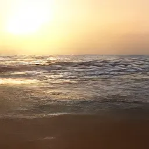
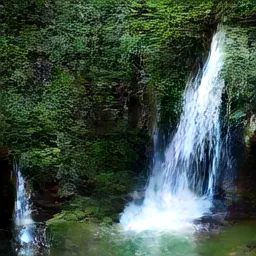
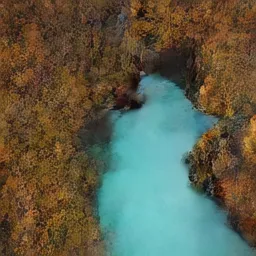
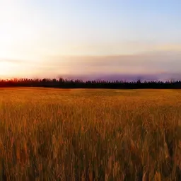
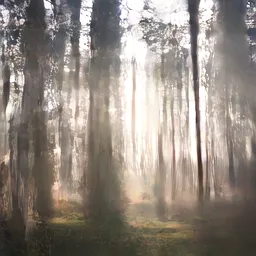
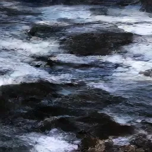
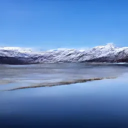
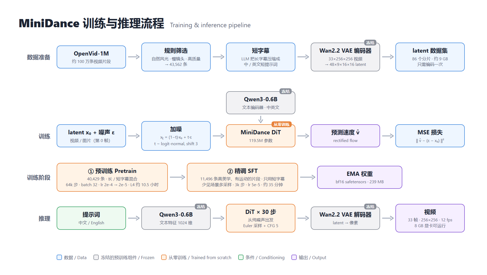
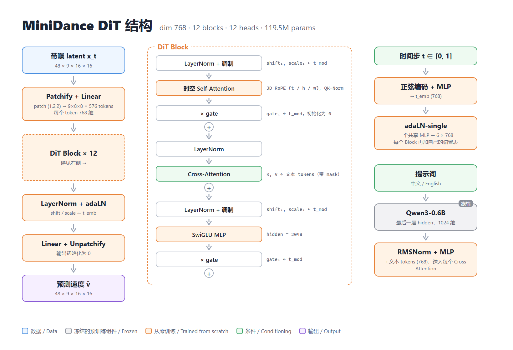
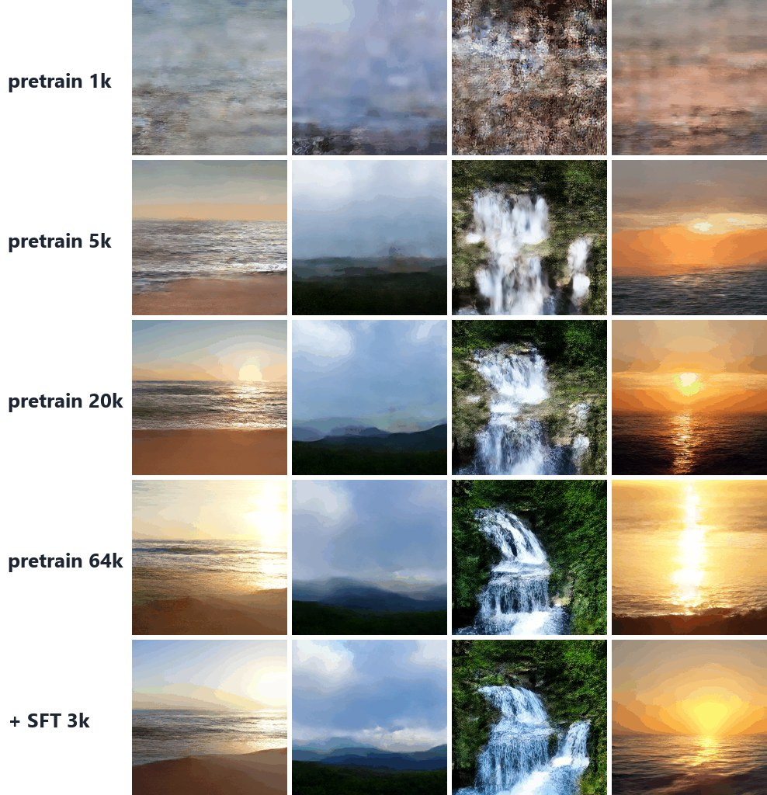

<div align="center">


</div>

<div align="center">

[](https://github.com/JuniverseLi/minidance/stargazers)
[](LICENSE)
[](https://github.com/JuniverseLi/minidance/commits/main)
[](https://github.com/JuniverseLi/minidance/pulls)
[](https://huggingface.co/JuniverseLi/MiniDance)
[](https://huggingface.co/datasets/JuniverseLi/minidance-scenery)

[中文](./README.md) | English

</div>

* MiniDance trains a **120M-parameter text-to-video model from scratch** for **about ¥12 (≈ $1.7)** — roughly **11 hours on a single Colab L4**.
* It focuses on **nature scenery in motion**: waves, waterfalls, forests, sunsets, drifting clouds. Give it an English or Chinese prompt and it generates a 33-frame clip; inference runs on an 8 GB GPU.
* The whole pipeline is open: data filtering, VAE selection, latent pre-encoding, short captions, pretraining, SFT, inference and visualization.
* The video DiT and the rectified-flow training / sampling are written from scratch in plain PyTorch, without high-level wrappers such as `diffusers` (only the frozen VAE and text encoder are borrowed).
* We hope it becomes a reproducible, readable and hackable starting point for video generation — what [MiniMind](https://github.com/jingyaogong/minimind) is for language models.

> Apache 2.0, completely free. "About 11 hours" is the measured pretraining + SFT time on one NVIDIA L4 (Colab); "about ¥12" is the matching Colab compute-unit cost (an L4 uses 1.54 units/hour; 100 units cost $9.99). This project is not affiliated with ByteDance / Seedance; the name is just a nod.

---

https://github.com/user-attachments/assets/90097d0e-61e5-40c8-a22c-d9be2a5fdc7f

<div align="center">

<table>
  <tr>
    <td align="center"></td>
    <td align="center"></td>
    <td align="center"></td>
    <td align="center"></td>
  </tr>
  <tr>
    <td align="center"><sub>Ocean waves rolling onto a sandy beach at sunset, golden light on the water.</sub></td>
    <td align="center"><sub>A waterfall cascading down mossy rocks into a clear pool.</sub></td>
    <td align="center"><sub>Aerial view of a turquoise river winding through autumn forest.</sub></td>
    <td align="center"><sub>Golden wheat field swaying in the wind at sunset.</sub></td>
  </tr>
  <tr>
    <td align="center"></td>
    <td align="center"></td>
    <td align="center"></td>
    <td align="center"></td>
  </tr>
  <tr>
    <td align="center"><sub>Sunlight streaming through tall pine trees in a misty forest.</sub></td>
    <td align="center"><sub>Ocean waves crashing against dark rocks.</sub></td>
    <td align="center"><sub>海上日落，金色余晖映在水面。<br/>(Sunset over the sea, golden light on the water.)</sub></td>
    <td align="center"><sub>湖面倒映着雪山，微风吹起涟漪。<br/>(Snowy mountains reflected in a lake, rippled by the breeze.)</sub></td>
  </tr>
</table>

<sub>Raw outputs of `minidance-base-sft` (256×256, 33 frames, 12 fps), cherry-picked among 3 seeds but otherwise unprocessed; prompts and seeds are in [demo/clips.json](./demo/clips.json).</sub>

</div>

---

# 📌 Introduction

Sora, Wan, HunyuanVideo, Kling… video generation keeps getting more impressive, but billions of parameters and thousands of GPUs leave individual developers at the "call an API" or "run inference" level. Opening the black box — seeing how a latent is denoised step by step into moving pictures — should be fun.

MiniDance asks: **can one person, for the price of a meal, train a text-to-video model from scratch that actually moves?**

Yes — if the problem is narrowed:

- **Narrow subject**: nature scenery only (live wallpapers). No people, animals or text; the model only needs texture-like motion such as flowing water, drifting clouds and changing light.
- **Narrow resolution**: 256×256, 33 frames. With the 16×16×4 compression of the Wan2.2 VAE a clip is only 576 tokens.
- **Stand on giants' shoulders**: the VAE (Wan2.2) and text encoder (Qwen3-0.6B) are frozen pretrained models; only the video DiT in the middle is trained from scratch — the same idea as [MiniMind-V](https://github.com/jingyaogong/minimind-v) freezing CLIP. What we want to learn and reproduce is generation itself.

---

#### 🎉 What's inside

- A complete video DiT ([model/dit.py](./model/dit.py), ~200 lines): 3D RoPE, QK-Norm, adaLN-single, text cross-attention, SwiGLU.
- Rectified flow / flow matching training and Euler + CFG sampling ([model/flow.py](./model/flow.py), ~50 lines).
- A data pipeline that filters 43,562 high-quality scenery clips out of OpenVid-1M (~940k clips) and pre-encodes them into latents.
- An open dataset: latent shards + English / Chinese short captions — download and train, no video processing needed.
- Pretraining and SFT scripts with time-limited runs, resuming, `torch.compile`, bf16 and EMA.
- Notebooks for Colab (in the browser, or from VS Code connected to a Colab runtime).
- An inference script that writes H.264 mp4 / GIF on an 8 GB GPU.
- Architecture diagrams and the demo video, made with [Remotion](https://www.remotion.dev/) ([demo/](./demo)).

#### 🎉 Released models

| Model | Params | Notes | Release |
|------|--------|------|---------|
| minidance-base-sft | 119.5M | pretrain + SFT, **recommended** | 2026.10.14 |
| minidance-base | 119.5M | pretrain only (64k steps) | 2026.10.14 |

---

# 📌 Quick start

## Step 0

```bash
git clone --depth 1 https://github.com/JuniverseLi/minidance
cd minidance

# option 1: uv (recommended; installs Python 3.12 and CUDA PyTorch)
uv sync
# option 2: pip (install CUDA PyTorch yourself first)
pip install torch torchvision --index-url https://download.pytorch.org/whl/cu128
pip install -r requirements.txt
```

> Commands below are written as `python xxx.py`; with uv use `uv run python xxx.py`.

## Ⅰ 🚀 Inference

### 1' Download the model

```bash
hf download JuniverseLi/MiniDance --local-dir ./out/MiniDance
```

> The first run also downloads the frozen Wan2.2 VAE (~2.7 GB) and Qwen3-0.6B (~1.5 GB).

### 2' Generate

```bash
python scripts/sample.py --ckpt out/MiniDance/minidance-base-sft.safetensors \
    --prompt "A waterfall cascading down mossy rocks into a clear pool." "海上日落，金色余晖映在水面。" \
    --seed 0 --gif
```

> One mp4 per prompt (plus a GIF with `--gif`) in `out/samples/`. Useful flags: `--steps` (default 30), `--cfg` (default 5), `--seed`. For a given seed each prompt's result does not depend on the other prompts in the batch.

## Ⅱ 🛠️ Training

Training needs a CUDA GPU. `base` with batch 32 uses about 14 GB; on an 8 GB card use `--batch 4` or `--preset small` to try the pipeline.

### 1' Download the data

```bash
hf download JuniverseLi/minidance-scenery --repo-type dataset --local-dir ./data
```

> You should get `data/latents/shard_*.safetensors` (86 shards, ~9 GB) and `data/short_captions.jsonl`.

### 2' Train

Every script supports `--max_minutes` (sample, save and exit when time is up) and `--resume` (continue from `<out>/ckpt.pt`). The learning rate follows a cosine schedule over `--steps`, so keep the same `--steps` across resumed runs.

```bash
# 2.1 pretraining
python trainer/train_pretrain.py --preset base --batch 32 --lr 2e-4 --warmup 1000 --steps 64000 \
    --sample_every 1000 --save_every 2000 --compile --resume --out out/pretrain
# 2.2 SFT: 11,496 high-aesthetic clips that move, short captions only, lr 5e-5, 3000 steps
python trainer/train_sft.py --init out/pretrain/ckpt.pt --compile --resume --out out/sft
# 2.3 export the EMA weights (bf16, 239 MB) and test
python scripts/export_weights.py out/sft/ckpt.pt out/minidance-base-sft.safetensors
python scripts/sample.py --ckpt out/minidance-base-sft.safetensors --prompt "White clouds drifting over green mountains."
```

Colab notebooks are in [notebooks/](./notebooks).

---

# 📌 Data

* **Source**: [OpenVid-1M](https://huggingface.co/datasets/nkp37/OpenVid-1M), read row by row from its [Lance version](https://huggingface.co/datasets/lance-format/Openvid-1M).
* **Filtering** ([dataset/filter_openvid.py](./dataset/filter_openvid.py), metadata only): Pixabay / Pexels / Mixkit sources; 13 scenery types matched in the captions; no people, animals, vehicles, buildings, text or CG; temporal consistency ≥ 0.993, motion 0.3–30, static or slow camera; at most 4 clips per source video → **43,562 clips**.
* **Short captions**: an LLM condenses each long caption into one English and one Chinese sentence plus a subject label; 3,133 clips labeled person / animal / vehicle / CG / text are dropped at training time, leaving **40,429**.
* **Latents**: each 2.67 s clip → 33 evenly spaced frames (~12 fps), full frame resized to 256×256 → Wan2.2 VAE → `48 × 9 × 16 × 16` bf16, 512 clips per shard. The VAE is not needed during training (only for the periodic samples).

| forest | ocean | river/lake | clouds | mountain | sunset | snow | waterfall | night sky | fog | rain/storm | aurora | fire |
|---|---|---|---|---|---|---|---|---|---|---|---|---|
| 10,166 | 9,214 | 5,450 | 4,358 | 3,817 | 3,305 | 2,905 | 2,086 | 1,049 | 905 | 156 | 76 | 75 |

To rebuild from raw videos: `dataset/fetch_openvid_meta.py` → `dataset/filter_openvid.py` → `dataset/encode_latents.py` (or `notebooks/encode_latents_colab.ipynb`). The short-caption script is not released; use `short_captions.jsonl` from the dataset.

---

# 📌 Model



| Component | Model | Params | |
|---|---|---|---|
| Video VAE | [Wan2.2 VAE](https://huggingface.co/Wan-AI/Wan2.2-TI2V-5B-Diffusers) (16× spatial, 4× temporal, 48 channels, causal) | — | frozen |
| Text encoder | [Qwen3-0.6B](https://huggingface.co/Qwen/Qwen3-0.6B) (last hidden state, 1024-d, EN / ZH) | 0.6B | frozen |
| Denoiser | **MiniDance DiT** | **119.5M** | **from scratch** |

The VAE was picked among LTX-Video 0.9.7, Wan2.2 and Open-Sora DC-AE ([scripts/s2_vae_bench.py](./scripts/s2_vae_bench.py)): ~31.5 dB PSNR at 256×256, and bf16 encoding matches fp32 while being 1.7× faster.



* **Joint space-time attention + 3D RoPE** over all 576 tokens; head dims split 1 : 1.5 : 1.5 between time, height and width.
* **QK-Norm** for stable bf16 training.
* **adaLN-single** (PixArt-α): one shared timestep MLP produces 6 modulation vectors; each block only adds a small learned table.
* **Zero-initialized residual branches** and output layer: the network starts as the identity.
* **Joint image / video training**: the causal VAE encodes video frame 0 alone into latent frame 0, so 20% of batches train on that single frame as an image.

| Preset | Params | dim | depth | heads | Use |
|---|---|---|---|---|---|
| tiny | 7.1M | 256 | 6 | 4 | debugging |
| small | 20.8M | 384 | 8 | 6 | overfit test |
| **base** | **119.5M** | **768** | **12** | **12** | **release** |

Objective: rectified flow, $x_t = (1-t)x_0 + t\varepsilon$, loss $\lVert v_\theta(x_t, t, y) - (\varepsilon - x_0)\rVert^2$, with logit-normal timesteps shifted by 3, 10% caption dropout for CFG, and 30-step Euler sampling with CFG 5.

---

# 📌 Experiments

## Ⅰ Cost

Single Colab L4 (24 GB), ~¥1.1 / hour; base, batch 32, `torch.compile` + bf16 ≈ 57 clips/s (6,400 steps / hour).

| Stage | Data | Steps | LR | Time | Cost |
|---|---|---|---|---|---|
| Pretrain | 40,429 clips, long + short captions | 64,000 | 2e-4 → 2e-5 | ≈ 10.5 h | ≈ ¥11.5 |
| SFT | 11,496 clips, short captions | 3,000 | 5e-5 → 5e-6 | ≈ 0.6 h | ≈ ¥0.6 |
| **Total** | | | | **≈ 11 h** | **≈ ¥12** |

Latent encoding is a one-off preprocessing step dominated by video download time; downloading our latent dataset skips it.

## Ⅱ Training progress

Same prompts and seed at different steps (middle frame of each clip): beach sunset, clouds over mountains, waterfall, and a Chinese prompt "sunset over the sea".

<div align="center">

</div>

The flow-matching loss is dominated by the randomly sampled noise level, so it hovers around 0.2–0.3 late in training even while samples keep improving — judge by the samples.

## Ⅲ What it can and can't do

| Good | OK | Weak / unsupported |
|---|---|---|
| forests, waves, rivers & lakes, sunsets, aerial shots, flowers & grass, clouds, mountains | waterfalls, fog, snow, autumn leaves, deserts, starry skies | glaciers, lightning, fire, aurora, rainbows, rain; people, animals, vehicles, cities, text |

---

# 📌 TODO

- [ ] Upload weights and dataset to HuggingFace / ModelScope
- [ ] Gradio WebUI and online demo
- [ ] Training dashboard: loss, learning rate and samples over time (like MiniMind)
- [ ] Multi-GPU (DDP)
- [ ] Higher resolution and longer clips
- [ ] Image-to-video

---

# 📌 Acknowledgements

[MiniMind](https://github.com/jingyaogong/minimind) · [OpenVid-1M](https://github.com/NJU-PCALab/OpenVid-1M) · [Wan2.2](https://github.com/Wan-Video/Wan2.2) · [Qwen3](https://github.com/QwenLM/Qwen3) · [DiT](https://arxiv.org/abs/2212.09748) · [PixArt-α](https://arxiv.org/abs/2310.00426) · [Stable Diffusion 3](https://arxiv.org/abs/2403.03206) · [Flow Matching](https://arxiv.org/abs/2210.02747) · [Remotion](https://www.remotion.dev/)

# ⚖️ License

Code and MiniDance weights: [Apache License 2.0](LICENSE). Third-party components keep their own licenses: Wan2.2 VAE and Qwen3-0.6B are Apache 2.0; the training data comes from OpenVid-1M (CC BY 4.0), whose videos come from Pixabay, Pexels and Mixkit and belong to their authors. This project only distributes VAE latents and captions, not the original videos.
